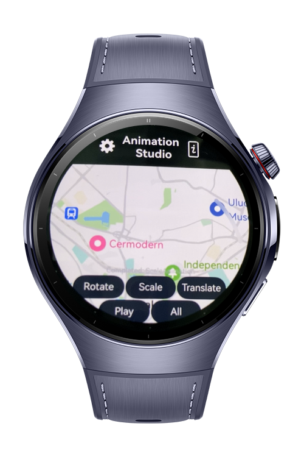
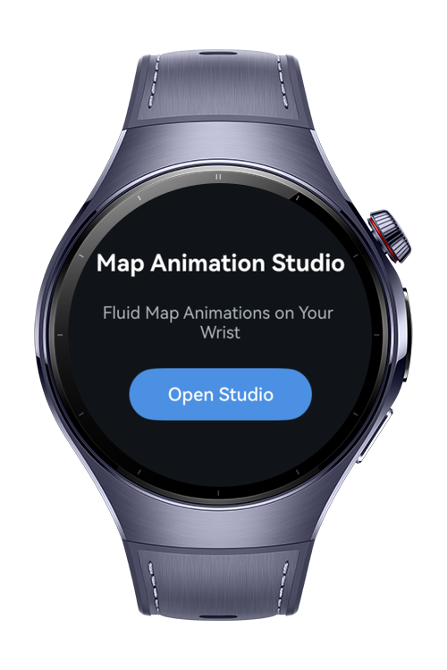
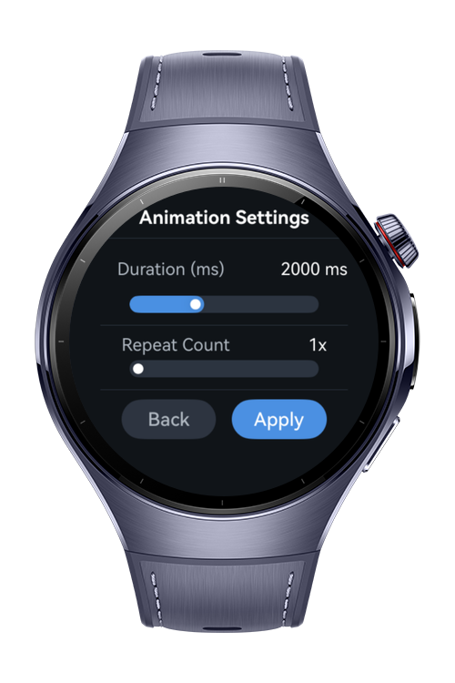
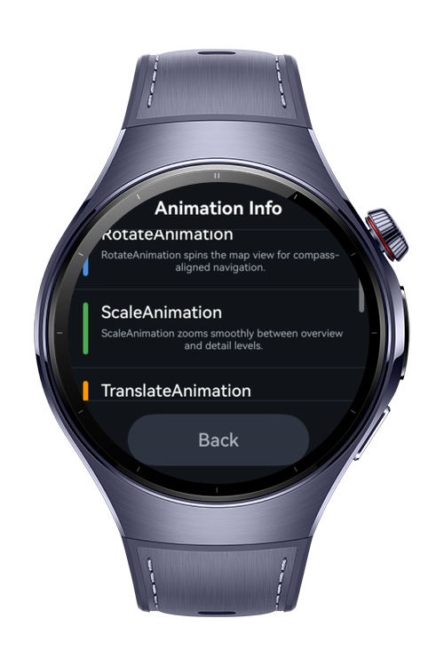

> **Note:** To access all shared projects, get information about environment setup, and view other guides, please visit [Explore-In-HMOS Index](https://github.com/Explore-In-HMOS/hmos-index).

# How To Build Map Animation Studio

Map Animation Studio is a HarmonyOS wearable application that demonstrates all five MapKit marker animation types on Huawei Watch devices. The app provides an interactive studio interface where users can trigger each animation individually or combined, and adjust playback settings such as duration and repeat count.

- **Rotate Animation**: Spins a map marker 360° around its anchor point using `RotateAnimation`.
- **Scale Animation**: Enlarges and shrinks a map marker between defined scale factors using `ScaleAnimation`.
- **Translate Animation**: Moves a map marker to a target position and resets it using `TranslateAnimation`.
- **Play Image Animation**: Cycles through a sequence of frame images on a marker using `PlayImageAnimation`.
- **Animation Set**: Combines rotate and scale animations into a simultaneous composite effect using `AnimationSet`.

# Preview

<div>
  
  
  
  
</div>

# Use Cases

**1. Learning MapKit Animations**

Developers can explore and compare all five MapKit marker animation APIs in a single runnable app, observing their visual behavior on a real wearable map.

**2. Animation Configuration**

Users can configure animation duration (500–5000 ms) and repeat count (1–5) via a dedicated settings page, immediately reflecting changes on the next animation playback.

**3. Combined Animation Playback**

The AnimationSet mode demonstrates how to compose multiple animations into a synchronized sequence, useful for building richer map-based UX on wearable devices.

**4. Reference Architecture**

The project shows the correct MVVM pattern for wearable map apps: `Navigation` + `NavPathStack` routing, `@ObservedV2` / `@Trace` state management, and a module-level singleton ViewModel.

**5. MapKit Integration on Watch**

Demonstrates the complete lifecycle for integrating `MapComponent` on a wearable, including marker creation, `mapLoad` event handling, and programmatic animation control.

Note: Please dont forget your agconnect-services.json file to rawfile folder
https://developer.huawei.com/consumer/en/doc/quickapp-get-agconnectfile

# Tech Stack

* **Languages:** ArkTS, ArkUI
* **Frameworks:** HarmonyOS SDK 6.1.0
* **Tools:** DevEco Studio 6.1.0
* **Libraries:** @kit.MapKit, @kit.BasicServicesKit, @kit.PerformanceAnalysisKit, @kit.ImageKit

# Directory Structure

```
entry/src/main/ets
├── common
│   ├── constants
│   │   └── AnimationConstants.ets
│   ├── models
│   │   └── AnimationConfig.ets
│   └── viewmodel
│       └── MapAnimationViewModel.ets
├── entryability
│   └── EntryAbility.ets
└── pages
    ├── AnimationInfoPage.ets
    ├── AnimationSettingsPage.ets
    ├── MapStudioPage.ets
    ├── NavigationRouter.ets
    └── SplashPage.ets
```

# Constraints and Restrictions
## Supported Devices
Huawei Watch 5 Series 

# License (MIT)

**how-to-build-map-animation-studio** is distributed under the terms of the MIT License.
See the [LICENSE](/LICENSE) for more information.
